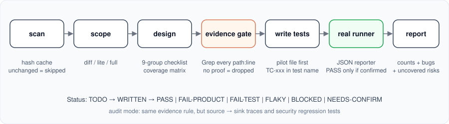

<div align="center">

# 🧪 qa-test-agent

**A Senior QC Automation Engineer for your AI coding agent.**
Designs, writes and runs *real* tests — no invented cases, no fake passes.

[](LICENSE)


[Install](#-install) · [Usage](#-usage) · [Modes](#-modes) · [How it works](#-how-it-works) · [Vietnamese / Tiếng Việt](#-tiếng-việt)

</div>

---

## ✨ Why

Most AI-written tests are green because they were written to be green. This skill is built around the opposite rule: **find real bugs with real evidence.**

| | |
|---|---|
| 🔎 **Evidence or it doesn't exist** | Every test case cites real code (`path:line`). No evidence → case is deleted. |
| ✅ **PASS only from a real runner** | Status is taken from the runner's JSON report and cross-checked against the todo. Never guessed. |
| 🚫 **No cheating to go green** | No weakened assertions, `.skip`, `waitForTimeout`, swallowed errors, blind snapshot updates, or editing source to make tests pass. |
| 🧠 **Not just happy paths** | 9-group checklist per unit: input, auth/state, dependency failures, concurrency, data integrity, time/locale, security, UX/a11y, happy. Gap cases for *missing* guards. |
| 🧬 **Tests must be able to fail** | P0 tests are checked against a deliberately broken copy to prove they catch the bug. |
| 💸 **Token-friendly** | Source-tree hash cache (`scripts/scan.mjs`) — unchanged files are never re-read. |
| 🛡 **Security audit mode** | `audit` traces user input source → sink with `path:line`, checks 13 vulnerability groups (injection, XSS, authn/z, SSRF, crypto, secrets, dependencies, CI/IaC…), masks secrets, never edits or attacks anything. |
| 🎭 **Playwright, with consent** | Asks before touching the UI, surveys the real DOM first, uses role-based locators. |
| 🖥 **Built-in UI check tool** | `scripts/ui-check.mjs` opens pages in Chromium (or installed Chrome/Edge) at desktop/tablet/mobile, saves aria snapshots + screenshots, and flags console errors, failed requests and basic a11y/layout leads. Local-only by default. |

---

## 📦 Install

Requires **Node ≥ 18** (for the cache scanner). Pick your agent:

### 🟠 Claude Code

```text
/plugin marketplace add maitrithanh/qa-test-agent-skill
/plugin install qa-test-agent@qa-test-agent-skill
```

Update inside a Claude Code session: `/plugin marketplace update qa-test-agent-skill`, then open `/plugin` → *Installed* → *qa-test-agent* → update.

Or from a normal terminal (works anywhere, e.g. the VS Code extension where `/plugin` is unavailable):

```bash
claude plugin marketplace add maitrithanh/qa-test-agent-skill
claude plugin install qa-test-agent@qa-test-agent-skill
```

Update (refresh the marketplace first, then the plugin; restart Claude Code afterwards):

```bash
claude plugin marketplace update qa-test-agent-skill
claude plugin update qa-test-agent
```

> `Plugin "qa-test-agent" is not installed`? Updating a marketplace does not install its plugins — run the `install` command above first.

Invoke: `/qa-test-agent:qa-test-agent` (or `/qa-test-agent` if installed manually)

<details>
<summary>Manual install (no plugin)</summary>

```bash
git clone https://github.com/maitrithanh/qa-test-agent-skill /tmp/qta
cp -r /tmp/qta/skills/qa-test-agent ~/.claude/skills/        # all projects
# or: cp -r /tmp/qta/skills/qa-test-agent .claude/skills/    # this project only
```
</details>

### 🔵 Gemini CLI

```bash
gemini extensions install https://github.com/maitrithanh/qa-test-agent-skill
```

Update: `gemini extensions update qa-test-agent` · List: `gemini extensions list`

### ⚫ OpenAI Codex

```bash
codex plugin marketplace add maitrithanh/qa-test-agent-skill
```

Then open the **Plugins directory**, choose *QA Test Agent* and install. Update: `codex plugin marketplace upgrade qa-test-agent-skill`

<details>
<summary>Manual install (no plugin)</summary>

```bash
git clone https://github.com/maitrithanh/qa-test-agent-skill /tmp/qta
cp -r /tmp/qta/skills/qa-test-agent ~/.agents/skills/        # all projects
# or: cp -r /tmp/qta/skills/qa-test-agent .agents/skills/    # this repo only
```
</details>

### 🟣 GitHub Copilot

Copilot has no marketplace — copy the skill folder. Works in VS Code agent mode, Copilot CLI and the cloud agent.

```bash
git clone https://github.com/maitrithanh/qa-test-agent-skill /tmp/qta
cp -r /tmp/qta/skills/qa-test-agent .github/skills/          # this repo
# or: cp -r /tmp/qta/skills/qa-test-agent ~/.copilot/skills/ # personal
```

### 🧩 Any other agent that supports `SKILL.md`

The skill is the open [Agent Skills](https://agentskills.io) format. Copy `skills/qa-test-agent/` into that agent's skills directory.

> ⚠️ The Gemini, Codex and Copilot manifests follow each vendor's public docs but are less battle-tested than the Claude Code one. If an install fails, please [open an issue](../../issues) with the error message.

---

## 🚀 Usage

```text
/qa-test-agent          # default: new/changed code only
/qa-test-agent lite     # whole project, P0 only, quick
/qa-test-agent full     # whole project, deep, P0–P3
/qa-test-agent audit    # security vulnerability scan (whole project or `audit <path>`)
/qa-test-agent repro <bug or issue>   # one failing test that reproduces a reported bug
```

On other agents, just ask: *"use the qa-test-agent skill in full mode"*.

First run asks two things: commit generated tests to git or not, and whether to use Playwright for frontend. Answers are saved in `.qa-agent/config.json`.

## 🖥 UI check tool

Standalone, works without the agent too (needs Playwright installed in your project):

```bash
node skills/qa-test-agent/scripts/ui-check.mjs http://localhost:3000/ http://localhost:3000/login --viewports desktop,mobile
```

| Option | Meaning |
|---|---|
| `--viewports` | `desktop` (1280×800), `tablet` (768×1024), `mobile` (375×667); comma-separated |
| `--out DIR` | output folder (default `.qa-agent/logs/ui-check`) |
| `--storage FILE` | Playwright `storageState` for logged-in pages |
| `--timeout MS` | navigation timeout (default 15000) |
| `--strict` | exit 1 if any lead is found (default exit 0: leads are not test results) |
| `--allow-remote` | allow non-local hosts — only for targets you own |

Output per page and viewport: `*.aria.txt` (accessibility tree), `*.png` (full-page screenshot) and `ui-check.json`. Exit codes: `0` ok, `1` leads with `--strict`, `2` bad usage / remote refused, `3` Playwright or browser missing (it never installs anything).

## 🎚 Modes

| Mode | Scope | Depth | Test types |
|---|---|---|---|
| `default` | Changed code + files it impacts | P0–P2 | unit, integration, e2e for changed routes |
| `lite` | Whole project, via cache summaries | P0 only | core unit + smoke e2e |
| `full` | Whole project, deep read | P0–P3, all techniques | unit, integration, e2e, a11y, responsive, regression, non-functional |
| `repro` | One reported bug | One failing test proving it; no fix unless asked | the cheapest layer that reproduces it |
| `audit` | Whole project or a path | Security findings, Critical → Info, with confidence | static source→sink tracing + security regression tests |

`full` shows the total case count and **asks for confirmation** before writing anything.

## ⚙️ How it works

<p align="center"></p>

```text
scan (hash cache) ─▶ scope ─▶ design cases ─▶ evidence gate ─▶ write tests ─▶ run real runner ─▶ report
                               │  9-group checklist   │ Grep every path:line     │ JSON → map TC-xxx
                               └─ coverage matrix     └─ drop unproven cases     └─ PASS only if confirmed
```

Everything lives in a gitignored `.qa-agent/` folder:

```text
.qa-agent/
  config.json  manifest.json
  cache/       # source-tree hashes + per-file summaries
  todo/        # the source of truth for every test case
  reports/     # run report: counts, bugs, blocked, uncovered risks
  logs/        # raw runner output
```

Case lifecycle: `TODO → WRITTEN → PASS | FAIL-PRODUCT | FAIL-TEST | FLAKY | BLOCKED | NEEDS-CONFIRM`

Full rules and workflow: [`skills/qa-test-agent/SKILL.md`](skills/qa-test-agent/SKILL.md).
The skill is written in English and replies in the language you write in. `SKILL.md` stays short (~230 lines); detail lives in `references/` and is loaded only when needed (`first-run`, `cache`, `case-design`, `writing`, `playwright`, `nonfunctional`, `audit`). That keeps token use low.

A Vietnamese copy lives in [`docs/vi/`](docs/vi/). To use it, copy `docs/vi/SKILL.md` and `docs/vi/references/` over `skills/qa-test-agent/` (keep `scripts/`).

## ❓ FAQ

<details>
<summary>Will it modify my source code?</summary>
No. It never edits source to make tests pass, never installs packages and never touches shared config without asking. Missing <code>data-testid</code>? It suggests one.
</details>

<details>
<summary>What if the code looks buggy?</summary>
It won't write a test asserting the wrong behavior. The case is marked <code>NEEDS-CONFIRM</code> as a suspected bug, and confirmed failures are reported as <code>FAIL-PRODUCT</code> with repro steps and <code>path:line</code>.
</details>

<details>
<summary>Which test runners are supported?</summary>
It follows your project's convention: Vitest, Jest, Playwright, and others it detects. It suggests one (and asks before installing) if none exists.
</details>

## 🧪 Evals

[`evals/`](evals/) holds a small app with 9 planted bugs and an objective scorer (bugs caught, false-positive tests). Use it to compare modes and skill versions before changing the rules — see [`evals/README.md`](evals/README.md).

## 🤝 Contributing

Issues and PRs welcome. Keep `SKILL.md` concise (details go to `references/`) and every rule verifiable; back changes with an `evals/` run. When releasing, bump `version` in `.claude-plugin/*.json`, `.codex-plugin/plugin.json`, `gemini-extension.json` and the version badge in this README, then tag `vX.Y.Z`.

## 📄 License

[MIT](LICENSE)

---

## 🇻🇳 Tiếng Việt

**qa-test-agent** là skill biến AI agent thành Senior QC Automation: thiết kế, viết và chạy test thật; không bịa case, không tự cho pass, không chỉ test happy path.

| Agent | Lệnh cài |
|---|---|
| Claude Code | `/plugin marketplace add maitrithanh/qa-test-agent-skill` rồi `/plugin install qa-test-agent@qa-test-agent-skill` |
| Gemini CLI | `gemini extensions install https://github.com/maitrithanh/qa-test-agent-skill` |
| Codex | `codex plugin marketplace add maitrithanh/qa-test-agent-skill`, rồi cài trong Plugins directory |
| Copilot | copy `skills/qa-test-agent` vào `.github/skills/` hoặc `~/.copilot/skills/` |

Claude Code từ terminal: `claude plugin marketplace add maitrithanh/qa-test-agent-skill` rồi `claude plugin install qa-test-agent@qa-test-agent-skill`. Cập nhật: `claude plugin marketplace update qa-test-agent-skill` rồi `claude plugin update qa-test-agent`.

Dùng: `/qa-test-agent` (mặc định), `/qa-test-agent lite`, `/qa-test-agent full`, `/qa-test-agent audit`.
